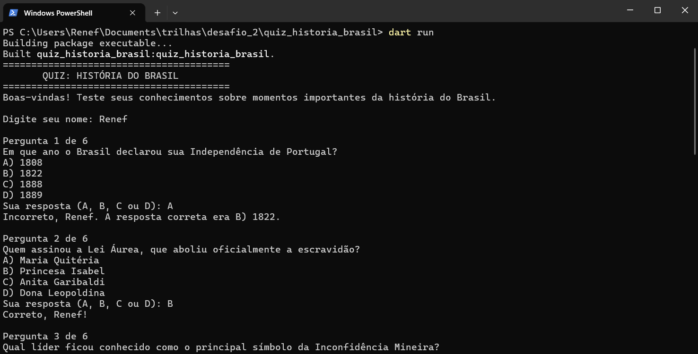
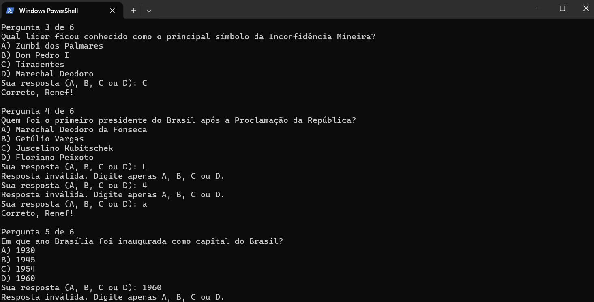
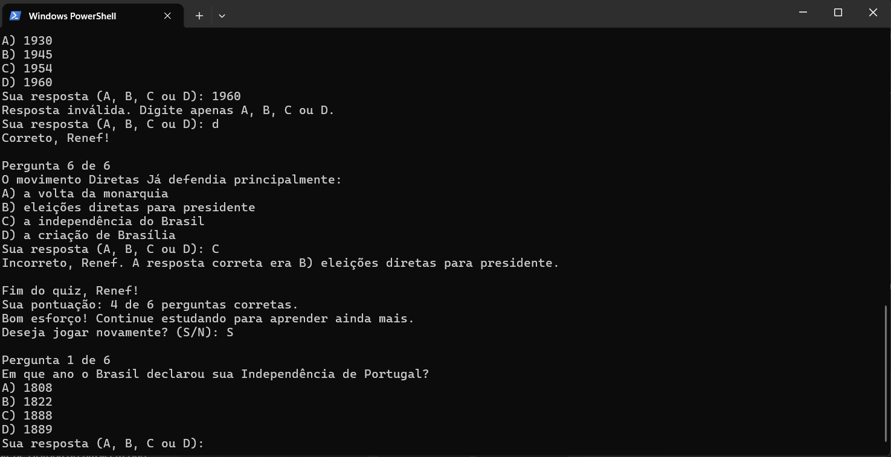

# Quiz: História do Brasil

Jogo de perguntas e respostas executado no terminal, criado para o **Desafio 2 - Meu Quiz** da trilha de **Desenvolvimento Mobile**.

## Integrantes

- Renef Ricardo Costa da Silva
- Juan Carlos Melo do Nascimento

## Sobre o quiz

O jogador informa seu nome e responde perguntas de múltipla escolha sobre a História do Brasil. Há um banco local de 30 perguntas, cada uma com quatro alternativas e uma resposta correta. O programa aceita letras maiúsculas ou minúsculas, avisa quando a resposta está incorreta e mostra a alternativa correta.

Antes da partida, o jogador escolhe 6, 12 ou 20 perguntas e define a dificuldade: Fácil, Média, Difícil ou Surpresa. No modo Surpresa, as perguntas são sorteadas entre todas as dificuldades. As questões ficam em `quiz_historia_brasil/data/questions.json`, são embaralhadas sem repetição em cada partida e o ranking é salvo localmente em `quiz_historia_brasil/data/ranking.txt`.

No menu inicial, a opção **Ver placar** permite consultar o ranking antes de começar uma partida.

Exemplo de pergunta: **Em que ano o Brasil declarou sua Independência de Portugal?**

## Tecnologias utilizadas

- Dart
- `dart:io` para arquivos e leitura com `stdin.readLineSync()`
- `dart:convert` para carregar as perguntas em JSON
- Listas, repetição `for`, condicionais e funções

## Como executar

Na pasta do projeto, execute:

```bash
cd quiz_historia_brasil
dart run
```

Para executar os testes:

```bash
dart test
```

## Capturas de tela

Execução do quiz no terminal, incluindo perguntas, validação de respostas e resultado final.







